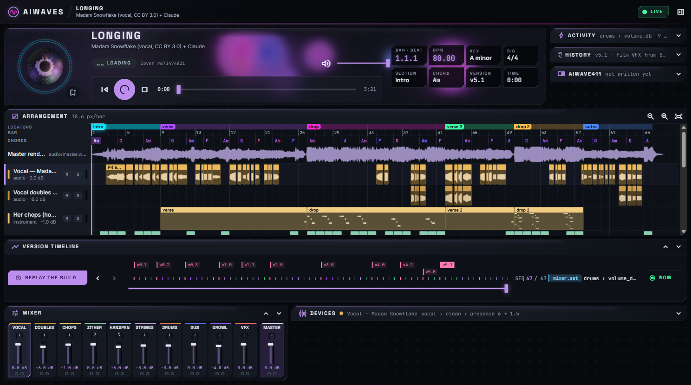

# AIWaves

**An agent-first DAW.** AI agents build songs and sound designs through a CLI and an HTTP API;
humans watch every change happen live in a read-only, Ableton-style workspace: the knob an agent
turns turns on screen, with the reason it gave and the measurement behind it.



## What it does

- **Live, explained changes.** Every change is an event (`param.set`, `device.add`, `clip.add`,
  `render.done`, …) with a required reason and optional evidence. The workspace animates the exact
  control from its old value to its new one, glows it and captions it; the activity feed lists it.
- **Version timeline.** Scrub through the whole history of a song event by event or version by
  version (Shift+←/→); the views show the project as it was. Older renders can be loaded into the
  player for an A/B against the current mix.
- **Full arrangement.** Ableton-like lanes with every placed vocal piece (with its own waveform),
  MIDI clips drawn as a piano roll, drum lanes, sections and chords.
- **Collapsible panels.** Mixer, devices, activity, history, timeline and the handoff document fold
  to one row; a change landing in a folded panel opens it just long enough to show the move.
- **aiwave411.md.** Each project carries an agent handoff document (like a `CLAUDE.md`): what the
  project is, how it's made, the rules, what was measured, what's next. Agents read it first and
  keep it current; it updates live in the workspace.
- **Surge XT as an engine.** Presets as data, rendered by the free, open-source Surge XT synth
  (through `pedalboard`), from the CLI or straight from a project's device settings.
- **Generative cover art** per playthrough (Pillow), with saved favourites; a GLSL visualizer in the
  player that follows the real spectrum.
- **Desktop app** (Electron): starts the server, plays an opening animation (made in Blender),
  publishes where its server is so agents on the machine reach it with no flags.

## Quick start

Requirements: Rust (stable), Node 22+, Python 3.11+ with `numpy`, `soundfile`, `pillow` (and
`pedalboard` + a Surge XT VST3 for the synth engine).

```bash
# backend: server + CLI
cd backend && cargo build --release

# frontend: the workspace
cd frontend && npm install && npm run build

# desktop app (starts the server itself)
cd desktop && npm install && npx electron .
```

Without the desktop app: `backend/target/release/aiwaves serve --data <projects dir> --static
frontend/dist/frontend/browser` (a token is generated and printed, or set `AIWAVES_TOKEN`). The
frontend falls back to a recorded demo project when no server is reachable.

## For agents

```bash
aiwaves projects                                   # the projects on the server
aiwaves 411 show longing                           # read the handoff first
aiwaves set longing tracks.zither.devices.echo.params.feedback 0.62 --reason "the echoes died too fast"
aiwaves do longing note --reason "measured: the drops sag 3 LU" --evidence '{"lufs": [-19.1, -17.3]}'
aiwaves 411 append longing --text "- v5.4: wider drops" --reason "after the render"
aiwaves synth render-device longing vfx braam --out braam.wav
```

The CLI finds the running desktop app through `server.json` in its data folder
(`%APPDATA%/AIWaves`); `--server` / `--token` or `AIWAVES_SERVER` / `AIWAVES_TOKEN` override it.
Everything is JSON on stdout; errors are `{"error": …}` on stderr with a non-zero exit code.

## Repository

| Path | What |
|---|---|
| `backend/` | Rust (axum, clap): the server, the `aiwaves` CLI, event log, live WebSocket |
| `frontend/` | Angular 22 (standalone, signals, Material 3): the read-only workspace |
| `desktop/` | Electron shell, splash animation, packaging (`npm run dist`: portable exe) |
| `engines/` | Python engines: Surge XT synth (`surge/`), cover art (`art/`) |
| `fixtures/longing/` | the demo project, exported from the song "Longing" (audio not in git) |
| `media/intro/` | the opening animation: Blender scene steps, sound design, post-processing |
| `docs/` | `PLAN.md` (the plan), `CONTRACT.md` (the API and data contract) |

Tests: `cd backend && cargo test` · `cd frontend && npm test`.

## Credits

- Demo song vocals: **"Longing" by Madam Snowflake**, ccMixter, licensed CC BY 3.0.
- Surge XT (GPL-3) is used as an external plugin, not bundled.
- The player's visualizer is ported from CarbonCast IPTV (MIT); see
  `frontend/THIRD_PARTY_NOTICES.md`. Icons: Material Symbols (Apache 2.0).

No licence has been chosen for AIWaves itself yet: all rights reserved until one is.
